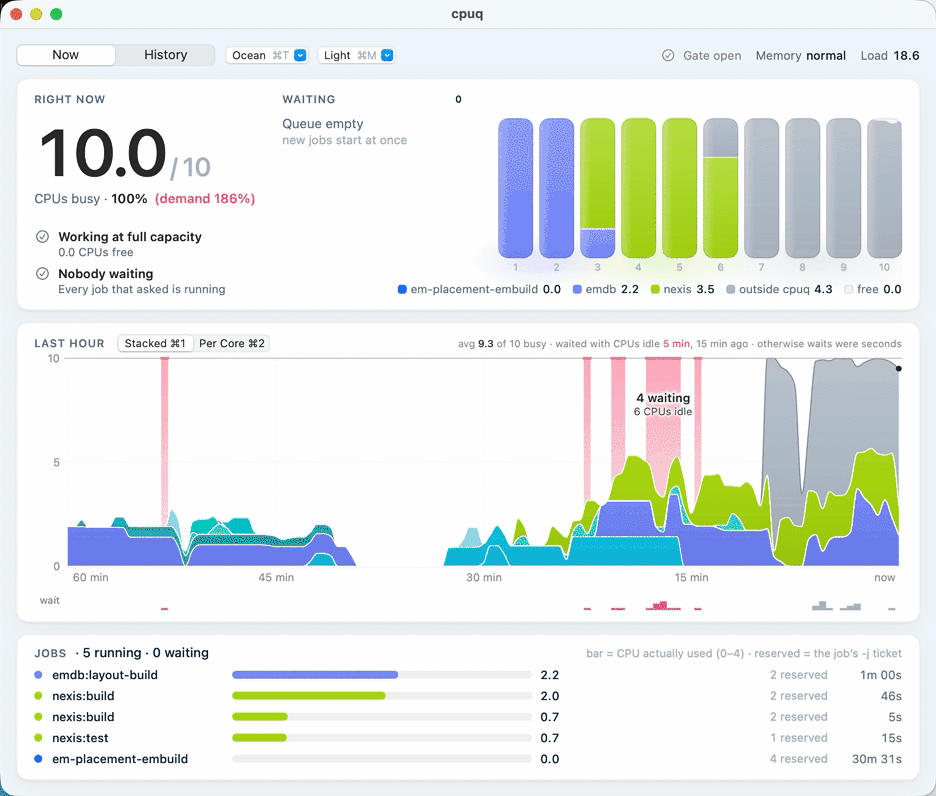

<p align="center">
  
</p>

<h1 align="center">cpuq</h1>

<p align="center">
  A machine-wide CPU pool for builds, tests, benchmarks and coding agents, on macOS and Linux.
</p>

cpuq is a CPU queue (say "CPU queue" or, lovingly, "see puke"). A machine has one token per CPU,
less a reserve. Every task started under cpuq, from any shell, session or agent, waits in one
fair line for a token, holds it while it runs, and gives it back when it ends. One binary, no
daemon: every run's record is a file its cpuq holds a `flock(2)` on, so the kernel releases it
however its holder dies.

The pool is per user. "Machine-wide" means across every process that user runs on the machine;
another user on the same machine has a pool of their own.

<p align="center">
  
  <br><sub>Cpuq.app, the menu-bar companion (see <a href="#cpuqapp-macos">Cpuq.app</a>)</sub>
</p>

## Quick start

    curl -fsSL https://raw.githubusercontent.com/shreeve/cpuq/main/install.sh | bash

    cpuq run --label app:build -- zig build -j1
    cpuq run --label app:test -n 40 -- sh -c './test/shard "$CPUQ_TASK" 40'
    cpuq status

The first is one task: it waits for its turn, then runs the build, at one job, with the terminal.
The second runs 40 tasks, as many at once as the line gives it tokens; each learns which it is
from `$CPUQ_TASK`, which cpuq sets for the command, so it is expanded inside `sh -c '…'`, in single
quotes. The third shows the tokens, what runs on them, who waits and why.

Agents: read [AGENTS.md](AGENTS.md).

### Install

`install.sh` downloads the latest release for macOS or Linux (arm64 or x86-64), checks it
against the release's sha256 checksums and installs `cpuq` to `~/.local/bin`, or to
`/usr/local/bin` as root (`BIN=DIR` picks another). `| bash -s v0.1.0` pins a version and
`| bash -s -- --uninstall` removes it. On a machine with several users, one copy on everyone's
`PATH` is enough: `curl … | sudo bash`. The Linux binaries are static.

With Homebrew: `brew install shreeve/tap/cpuq`. From source, with Zig 0.17.0:
`zig build install -Doptimize=safe -p ~/.local`. In a checkout, `zig build` writes `bin/cpuq`,
`zig build test` runs the unit tests and `test/run.sh` the end-to-end tests against `bin/cpuq`.

## Why

A job knows how much parallel work it has. It cannot know how many CPUs it should use, because
that depends on everything else the machine runs, and no single process sees that.

- **Each job tuning itself to the CPU count** assumes it owns every CPU. With several sessions
  and agents each starting `-j10` builds on a 10-CPU machine, that is 30 or more threads on 10
  CPUs, and every job crawls.
- **Each job reserving cores by guess** leaves them idle: a job that asks for 16 and keeps 2 busy
  holds 14 that nobody else may use.
cpuq hands out CPUs, not wishes. The machine has as many tokens as CPUs less a reserve; a task holds
one while it runs, pinned to its CPU on Linux, and gives it back the moment it ends. At most that
many tasks run, however many runs ask, and a job holds the one token it runs on, never the 14 it
might have asked for. A project under its fair share is first in line for a freed token. Parallel
work is many tasks, and every task runs at one job.

**Hasn't someone solved this already?** Pieces of it, many times over: global make jobservers,
job spoolers, Google's Borg, Meta's Buck2, benchmark locks, and in 2026 a wave of build locks for
AI agents. [docs/PRIOR-ART.md](docs/PRIOR-ART.md) surveys them all: what each does, what cpuq
borrows, and what is new here.

## Words

| word | meaning |
|---|---|
| CPU | a logical processor, as the OS counts them |
| pool | the CPUs cpuq counts: by default every CPU online (see [The pool](#the-pool)) |
| reserve | the pool's last CPUs, never handed out (config `reserve`, 2 by default) |
| token | one CPU of the pool less the reserve, held by one task at a time: the machine has N of them |
| run | one `cpuq run` (status calls it an operation, `OP`): M tasks of one command |
| task | one process of a run, which holds one token while it runs |
| line | the order in which waiting runs take a freed token |
| ticket | a run's number, its age in the line |
| project | the repo a run is started in (a worktree counts as its repo), else its label's project |
| weight | a project's share of the tokens, relative to others (config `weights`; default 1) |
| fair share | a project's tokens by its weight, among the projects with tasks running or waiting |
| label | a run's name, `project:task`; history is kept by label |
| gate | a machine check that holds every start: memory pressure, low memory, low disk |
| drain | `cpuq drain`: N whole cores' tokens taken for one command, for timing |
| named lease | a queue for something that is not CPUs: a database, a device, another machine |

## cpuq run

    cpuq run [-n M] [-c C] [-t T] [-r N] [--label PROJECT:TASK] [--note TEXT]
             [--urgent] [--wait-max S] [--driver] [--on HOST ...] [--] CMD ARGS...

| option | meaning |
|---|---|
| `-n M` | M tasks of CMD; each gets `CPUQ_TASK` (1 to M) and `CPUQ_TASKS`, and its output goes to a file of its own. Without `-n`, one task, with the terminal |
| `-c C`, `-c P%` | hold at most C tokens at once, or P% of the tokens (at least 1); default: none of its own |
| `-t T` | each task's time limit, wall time (not the time you stop it with Ctrl-Z): `30s`, `10m`, `2h`, or `off`; default the config's `timeout` (1h) |
| `-r N` | try a failed task up to N more times; `CPUQ_ATTEMPT` says which try it is |
| `--label PROJECT:TASK` | the run's name in status and history |
| `--note TEXT` | what the run is for, kept beside its label in history |
| `--urgent` | its first task goes ahead of the line: a rebuild someone is waiting on |
| `--wait-max S` | give up (exit 75) if no task starts within S seconds; nothing runs. `0`: now or not |
| `--driver` | a test runner that starts `cpuq run`s of its own: it is no task, and each run it starts takes its own turn |
| `--on HOST` | run on HOST, one of this machine's remotes (see [Other machines](#other-machines---on-host)) |

### One task

`cpuq run -- CMD` waits for its turn, then runs CMD in the foreground: stdin, stdout and stderr
are inherited (a terminal stays a terminal), it shares cpuq's process group (so `^C` reaches it),
signals sent to cpuq are forwarded, and CMD's exit status is cpuq's. When CMD dies by a signal,
cpuq dies by the same one. At its time limit CMD gets SIGTERM, and cpuq exits 124.

A task holds one CPU, so run what it runs at one job:

| tool | after `cpuq run --label … --` |
|---|---|
| zig | `zig build -j1` |
| make | `make` (no `-j`) |
| cargo | `cargo build -j 1` |
| go | `go build -p 1 ./...` |
| swift | `swift build -j 1` |
| ninja | `ninja -j 1` |
| pytest | `pytest` (no `-n`) |

A bare `zig build`, `cargo`, `go build` or `swift build` starts a job for every CPU of the machine,
and one task holds one token: on Linux its jobs share the one CPU it is pinned to, and on macOS
they take other tasks' CPUs. Parallel work is tasks: `-n M`.

### Many tasks: -n M

`cpuq run -n M -- CMD` runs CMD M times. It takes a token for a task whenever the line lets it, at
most `-c` at once, until all M have run:

    cpuq run --label app:test -n 40 -- sh -c './test/shard "$CPUQ_TASK" 40'
    cpuq run --label app:fuzz -n 500 -t 2m -r 1 -- sh -c './fuzz "$(sed -n "${CPUQ_TASK}p" cases.txt)"'
    cpuq run --label app:fetch -n 200 -- sh -c 'curl -fsS "$(sed -n "${CPUQ_TASK}p" urls)" >/dev/null'

- **Before it starts** it says what it will do, so a misread `-n` shows at once:
  `cpuq: 40 tasks, up to 40 at once, timeout 3600s`.
- **Each task** runs in a process group of its own, with stdin from `/dev/null` and stdout and
  stderr to `~/.local/state/cpuq/runs/PROJECT/STAMP-PID/N` (a retry's to `N.ATTEMPT`). When a task
  ends, whatever it left running in its group is killed.
- **At the end** it prints a summary on stderr, then each failed task's last five lines (the first
  five failed tasks):

      cpuq: 38 of 40 tasks passed, 2 failed (1 at the time limit), in 41.3s; output in ~/.local/state/cpuq/runs/app/1795675001-92874
      cpuq: task 17 (attempt 1) exited 1; the end of ~/.local/state/cpuq/runs/app/1795675001-92874/17:
          ...

- **Exit status:** 0 when every task passed, else 1. A run stopped by a signal (`^C`, `cpuq kill`)
  passes it to every task, kills what is left 5 seconds later, and dies by that signal.
- **Work that waits** (network, a server, sleeps) holds its token while it waits, and keeps the CPU
  idle: keep waits out of tasks, or give the run a `-c` that suits.
- **`-t T`** limits each task: at T it gets SIGTERM, then SIGKILL 5 seconds later; it counts as
  failed (124), and the next task starts. It counts wall time, less any time you stop the run
  with Ctrl-Z. A sensible T is about ten times the task's usual time. With
  no `-t`, the config's `timeout` (1 hour) applies, so no task runs forever.
- **`-r N`** tries a task that failed (non-zero exit or its time limit) up to N more times, after
  the tasks not yet started. Tasks stopped by a signal are not tried again.
- **`-c C`** is a hard limit: the most tokens the run holds at once, as a count or a
  percentage of the tokens, worked out when the run starts. It is a ceiling, never a claim: the line
  decides how many it holds below it.

### Environment

Each task gets `CPUQ_TASK` (1 to M, 1 for a single task), `CPUQ_TASKS`, `CPUQ_OP` (its run's
ticket), `CPUQ_ATTEMPT` and `CPUQ_ATTEMPTS` (`-r` + 1). On Linux a task is pinned to its token's CPU;
on macOS the kernel decides which CPU it runs on.

### --wait-max, --urgent

`--wait-max S` gives up after S seconds while the run has started no task, with exit 75; the
command never ran. `--wait-max 0` starts now or not at all.

`--urgent` puts the run's first task ahead of the other runs of its project, and in the line ahead
of every project not under its share, once per project at a time (while another of its project's urgent runs has not started its first task, it waits its
turn). It never stops a running task. Use it for a rebuild someone is waiting on.

### --driver: a test runner

A test runner that starts a `cpuq run` per test (swarm, a `test/run` script) runs under
`--driver`: it is no task of its own and takes no turn, and each run it starts is admitted on
its own. It runs with the terminal, and its exit status (or signal) is cpuq's. On Linux, with
`cgroups` (on by default), it runs in a delegated systemd user scope of its own
(`cpuq-driver-PID`, in `cpuq.slice`), its command in the scope's `job/`, and `$CPUQ_CGROUP`
names the scope, so `cpuq cap` can give each program it starts a cgroup beside `job/`, with limits
the kernel enforces. The runs it starts stay in that scope. Whatever it leaves in the scope is
killed when it ends. Where `systemd-run --user` doesn't work, it runs as it is, and `cpuq cap`
watches the slow way.

A driver is in the pool as a run with no task and no token, so status lists it. Once a second it measures what
its runner's own process tree keeps busy, the runs it starts left out. From 0.5 CPUs that counts
against its project's share, and status flags it (`driver_cpu`: the driver computes
N CPUs itself; run its work as tasks).

`cpuq hook` accepts `--driver` for any command but a bare build directly under it (zig, cargo,
make, go, swift, xcodebuild): a build is a task, and belongs in the line as one. Rig's split build
is a runner: with `RIG_UNIT_LAUNCHER` a `cpuq run`, each unit's compile is a run of its own,
admitted on its own (the link runs in the driver):

    cpuq run --driver --label rig:build -- env RIG_UNIT_LAUNCHER='cpuq run --' rig build --units=8 app.rig

### Nested runs

A `cpuq run` inside a task (`CPUQ_OP` naming a live run, or, when the environment was cleared, an
ancestor process that is a run's cpuq) starts at once, within that task, with no line. One task
replaces the nested cpuq (exec); `-n M` runs its M tasks one at a time, with the terminal, and
exits 0 when all passed, else 1. So a script run under cpuq may call others that use cpuq.
Parallel work goes at the top: `cpuq run -n M`, or `--driver`.

### Labels

Give every run a label, `project:task`, the same on every run: `app:build`, `app:test`,
`site:deploy`. A label is parts split by `:`, each of lowercase letters, digits, `.`, `_` and `-`,
none starting with `.`; anything else is a usage error. History is kept by label, so a label with a
run id, date or branch name in it never has a history. A run with no label is named after its
command.

## How CPUs are shared

The machine has N **tokens**, one per CPU of the pool less the reserve. A task holds one while it
runs, and gives it back the moment it ends, so at most N tasks run at once, however many runs
ask: runs asking for 500 tasks between them still run N. On Linux a task is pinned to the CPU of
its token, so no two tasks of cpuq's share a CPU.

### The pool

The pool is the CPUs cpuq counts, in a fixed order that every cpuq on the machine works out the
same way:

- `cpus = LIST` in the config (a Linux CPU list, `12-19,2`) is the pool, in that order: on pup, its
  E-cores, say.
- Otherwise, on Linux: the CPUs online, less those isolated from the scheduler, within the CPUs the
  machine's init may use (a container's CPU set); one hyperthread of each physical core first,
  then their siblings. On macOS: CPU 0 to the active count less one.

The **reserve** is the pool's last R CPUs in that order, never handed out (config `reserve`,
default 2). The rest are the tokens: N = the pool less R, at least 1. A 10-CPU Mac has 8 tokens.
`cpuq reserve` prints them (`8 tokens, 2 reserved`), `cpuq reserve 4` sets the reserve (`--host
HOST`: on HOST), and `cpuq budget` prints N alone, for a script that sizes its load by it
(`-n $(( $(cpuq budget) / 2 ))`). A new reserve is kept in the config and is in force at once:
running tasks finish, and fewer start until fewer than the new N run.

### Admission

A run takes a token for its next task when it is first in line for one:

- **A token per task.** A task holds a token from its start until it ends. Tokens free are N,
  less those held (by each running task, and by each drain's CPUs), less those held back for work
  outside cpuq (below). A run with no free token waits; its `-c` is the most it holds at once.
- **Fair share.** A project's share is F = N × its weight ÷ the weights of the projects with
  tasks running or waiting. Weights are per project, `weights = rig:2 trig:1` in the config; a
  project not named weighs 1.
- **One line.** Each project's first waiter is its run that goes first: an `--urgent` run's
  first task, then the run running the fewest tasks, then the older turn (when its last task
  started, or, for a run that has started none, when it arrived), then the older ticket. So a long
  `-n` run never keeps a newer run of its project waiting, and a stream of newer runs never keeps
  the long run waiting. Of the projects' first waiters, only the first in line takes a freed
  token: projects under their share first, then an `--urgent` run's first task, then the project
  running the fewest tasks for its weight, then the run running the fewest, then the older
  ticket. Two runs never race for one token.
- **Hard limits** hold whatever the share: a run's `-c`, and the gates.

So ten runs of one task each on a ten-CPU Mac start eight at once, and the other two wait for a
token in line order. A 5,000-task run that fills the machine gives a second project its share as
its tasks end: each freed token goes to the project under its share, not to the long run's next
task.

### Where tasks run

**Linux.** Each task's process tree is pinned (`sched_setaffinity`) to its token's CPU, and
its children inherit that, so a task that starts several jobs shares its one CPU among them. A
run stopped with Ctrl-Z gives its tokens back; continued, each task goes on, on the CPU of the
token it then holds, which may be another's.

**macOS** has no affinity: a token is a count, and the kernel places tasks. cpuq never stops a
task to share time: a stopped task can hold a lock others wait on (five zig builds once stalled
on one cache lock).

### Outside load and the gates

**Outside load.** Work cpuq doesn't run (Spotlight, a build typed outside cpuq) takes CPUs too.
The CPUs cpuq leaves to it are the reserve and any CPU outside the pool; for each whole CPU it
keeps busy beyond those, one token is held back while it runs (3 CPUs busy outside with a reserve
of 2 hold back 1). The busy figure is the kernel's CPU ticks, never the load average, which
counts threads waiting on I/O and lags a minute. `outside_check = off` holds none back.

**The gates** hold every start while they are closed; running tasks keep running:

- **memory pressure** (`pressure_check`): macOS's critical level; on Linux, `some avg10` in
  `/proc/pressure/memory` at `pressure_psi` (10) or more;
- **low memory** (`min_available`, off by default): available memory under that size;
- **low disk** (`min_disk`, 5G): less than that free on the filesystem holding `$HOME`, the one
  holding cpuq's state directory (the temp directory), or, where it is a filesystem of its own,
  `~/cpuq`, where jobs sent here keep their copies, caches and scratch. A full disk fails every
  task and every tool that writes a file, so the pool starts no new ones until there is room.

### Ctrl-Z, kill and a dead run

- **Ctrl-Z** on a run stops every task and then stops cpuq. While stopped its tasks hold no
  token and it starts nothing, so the line passes it by (a stopped `cpuq drain` ends its
  isolation). A continue sent at once after the stop leaves it running, as `kill -TSTP; kill
  -CONT` from a script expects. Continued (`fg`), each task goes on once it holds a token again.
  Time stopped doesn't count against a task's limit.
- **`cpuq kill TICKET|PID|LABEL`** ends a run on this machine, waiting or running: its cpuq gets
  SIGTERM, passes it to every task, and kills what is left 5 seconds later. A label that names
  several runs lists them, to be named by ticket. It acts on anyone's runs, not only the caller's.
- **A run whose cpuq dies** (SIGKILL, a tool's timeout) leaves its record unlocked, since the
  kernel drops its `flock`. Whoever next scans the pool finds it, kills the tasks it noted (each
  by pid and start time, so a reused pid is safe), and removes it. On Linux each task also dies
  with its cpuq (`PR_SET_PDEATHSIG`).

## cpuq limit: change a run's -c

    cpuq limit TICKET|PID|LABEL -c C [--host HOST]

A run's `-c` can change while it runs: `cpuq limit emdb:model -c 8`, or `-c 75%` of the tokens.
Name it as `cpuq kill` does, by the ticket `cpuq status` shows, its cpuq's pid,
or its label when only one run has it. Raised, the run takes more tokens as the line allows. Lowered,
it takes none until it holds fewer; nothing is killed. `cpuq status` flags a run held back by its own
`-c` (`capped`): tasks queued under it while tokens are free. A drain's CPUs are fixed when
it starts.
it starts.

## cpuq drain: timing

    cpuq drain -c N | --cpus LIST [--prefer fast] [--quiet-max X] [-t T] [--max T] [--label L] [--] CMD ARGS...

For timing, nothing else. A drain times CMD on CPUs of its own while the rest of the machine
keeps working. It takes its turn, then isolates at once: nothing is gathered or held while it
waits.

- **`-c N`**: N CPUs, the ones CMD runs on. By default they come from the end of the tokens' order;
  `--prefer fast` takes performance cores first (Linux: `/sys/devices/cpu_core/cpus`, then
  `cpu_capacity`, then `cpuinfo_max_freq`). `--cpus LIST` names them instead (a Linux CPU list,
  all tokens, so none in the reserve; `-c`, if given, must agree; it can't combine with `--prefer`).
- **Whole cores.** A drain isolates its CPUs and their SMT siblings (`thread_siblings_list`), so
  no other work shares their cores. `CPUQ_CPUS` and the pin are only the N CPUs (as `taskset -c`
  takes them; use it, not CPUs of your own); the siblings stay idle. Siblings that are tokens are
  taken with them and count toward `drain_max`; one that is no token (the reserve, or outside the
  pool) has no task of cpuq's anyway and counts for neither. N whole cores whose tokens exceed
  `drain_max` are a usage error.
- **Tokens.** Every task holds a token and runs on that token's CPU, so a drain takes the tokens
  of its cores, all at once, when all of them are free. **Linux:** CMD is pinned to its CPUs, and
  no task of cpuq's is on them. **macOS:** the same, without the pin. All drains together hold at
  most `drain_max` of the tokens (config; half by default).

A drain's turn comes after the older runs that wait holding nothing (no task running yet), and
after older drains; it also waits for the `drain_max` bound (a change to the config reaches a
drain already waiting). Once its turn has come, it waits until the tokens of N whole cores are
all free (with `--cpus`, those CPUs'). It holds none while it waits, and freed tokens go to runs
as usual, so on a busy machine it may wait: `cpuq status` says so (`waits for 2 whole cores to be
free`), and `--max T` (`90s`, `10m`) gives up if CMD hasn't started by then (exit 75), and nothing
runs. A run already running tasks goes on beside it. Runs that queue after it don't wait for it.
Ctrl-Z on a drain ends its isolation and gives its tokens back; continued, it takes its turn
again before its command continues.

A drain must end on time and use what it isolates:

- **`-t T`** is its command's time limit, counted from its isolation (a quiet wait included): 20
  minutes unless it says otherwise (config `drain_timeout`), at most 2 hours, never off. At the
  limit the command gets SIGTERM, then SIGKILL 5 s later, and cpuq exits 124. Whatever its record
  says, a drain isolates at most its limit plus 60 seconds.
- **An idle drain is stopped.** A command that keeps under 0.25 CPUs busy in all (CPU seconds a
  second) for 5 minutes (config `drain_idle`; off: never) while another run waits is warned
  halfway, then stopped the same way. A benchmark computing on one CPU is real timing and runs on;
  a script that sleeps or waits on the network is not.
- History says which stopped it (`124 time limit`, `124 idle`), and `cpuq status` flags a drain
  past `drain_timeout` or idling.

**Noise.** Once a second while a drain isolates, the busy share of its CPUs (kernel ticks; on
macOS the machine's busy CPUs, beyond the CPUs it leaves to others) less its own command's CPU
time is work from outside it: kernel threads, interrupts, processes cpuq doesn't run. `cpuq status` flags a drain `noisy` at 0.1 CPUs or more and names the
busiest such process (by the CPU it last ran on), and history's ended line carries
`noisy: {cpus, max, top}` (the mean while CMD ran, the most, the busiest process) when the most
reached 0.1.

`--quiet-max X` waits for quiet: after isolating, CMD starts
once a one-second look finds the work from outside at X CPUs or less (`--quiet-max 0.05`). It
gives up with exit 75 ("never quieted") at `--max` or at its `-t`.

Its own builds and helpers run inside it as nested runs. A drain that spans several commands
wraps them in one: `cpuq drain -c 4 --label app:bench -- ./bench.sh`.

Time on as few CPUs as the measurement needs: a drain leaves the machine working. For a quieter
machine, use another machine through a named lease (`cpuq lease bench --host buildbox -- ssh
buildbox 'cd repo && cpuq drain -c 4 -- ./bench'`). Work outside cpuq (system services) still
runs; `cpuq status` shows it.

## Watching

### cpuq status

    cpuq status [--host HOST]... [--json] [--no-usage] [--watch[=SECONDS]]

`cpuq status` shows the tokens and who holds them, the line and why each run in it waits:

- **The machine:** the pool's CPUs, the tokens (`8 tokens, 2 reserved; 5 held, 3 free`, and any
  held back for outside work), tasks running and waiting, the CPUs busy
  of those online, split into cpuq's tasks and work outside; the load, memory pressure
  and the gate; memory and swap. When work outside cpuq uses a CPU or more, or a gate is closed,
  that work by what started it: each busy process counts toward the top of its tree just below its
  starter (an agent's harness, an ssh session, a terminal, a service manager), shown with its
  command (an agent's own, out of its harness's wrapper), where it runs, the starter and its pid,
  its busy processes and the CPUs they keep busy. So `ssh burst 'make -j'`, or a build an agent
  ran without cpuq, shows as one line naming the command and its folder. Apps and system services
  (detached, running in `/`) count in the load but aren't listed; `--json` keeps them.
- **Running:** each run's ticket (`OP`), pid, project, label, tasks done of total and failed (once only running tasks are left, the tail: `last task,
  running 32m`, `last 3 tasks, oldest running 32m`; a single task: `running 32m`), its
  tasks running and the CPUs whose tokens they hold (`3 on 0-2`; ` · N stopped` for tasks cpuq has stopped, ` · N on I/O` for tasks with a process in state D on Linux), the CPUs they keep busy, how long, an estimate of the time left, and
  its command. A note under it flags a run whose tasks keep more than 1.2 CPUs busy each
  (`over_cpu`), one held back by its own `-c` (`capped`), one stopped (Ctrl-Z), and a drain that
  idles (`idle_drain`), runs past `drain_timeout` (`long_drain`) or has work from outside on its
  CPUs (`noisy`).
- **Waiting:** in line order, each run's ticket, project, label, the tasks it could start and the
  ones it runs, and why it waits: `1st in line; every token is held`, a closed gate, a drain
  (`waits for 2 whole cores to be free`).
- **Projects:** each project's weight, runs, tasks running and waiting, and its fair share.

On a terminal it draws boxed tables in color (`NO_COLOR` drops the color); anywhere else, plain
lines.

- `--json` is for programs (below). `--watch` redraws on a terminal every 2 seconds
  (`--watch=N`: every N) until `^C`; it refuses to run without a terminal or with `--json`.
- `--no-usage` skips the half-second sample of what each run uses.
- `--host HOST` shows HOST's status, fetched over ssh; it repeats, and `--host local` is this
  machine, so `cpuq status --host local --host buildbox` is one view of both.

`cpuq status --json` is one object (with several `--host`s, one per host, keyed by host). Its
`schema` (4) changes only when a field is removed or changes meaning; new fields may appear.

| field | meaning |
|---|---|
| `schema`, `version`, `dir`, `admit` | 4, cpuq's version, the pool's directory, and `tokens` |
| `pool`, `tokens`, `token_cpus`, `reserve` | the pool's CPUs; the number of tokens (N: at most N tasks run at once); their CPUs (the pool's first N); the reserve (the pool's last CPUs, never handed out) |
| `held`, `held_back`, `free` | tokens held (by tasks running and by drains), held back while work outside cpuq keeps more than the CPUs cpuq leaves it busy, and free |
| `isolated` | the CPUs drains isolate |
| `running`, `paused`, `waiting` | cpuq's tasks running (each holding a token), tasks cpuq has stopped (holding none: after a Ctrl-Z, until each holds a token again; a drain's command waiting for its turn again), and tasks waiting to start |
| `busy`, `tasks_busy` | CPUs busy on the machine, and of those, cpuq's tasks |
| `cores`, `active_cores` | the machine's CPUs, and those active now |
| `load`, `memory_pressure` | the 1-, 5- and 15-minute load; `normal`, `high`, `unknown` or `off` |
| `memory` | bytes: `total`, `used`, `swap_total`, `swap_used`; null when unreadable |
| `gate` | `state` (`open`, `pressure`, `low_memory` or `low_disk`), `available`, `disk_free`, `disk_path`, `text` |
| `runs[]` | runs with tasks running (or a drain isolating): `ticket`, `pid` (its cpuq), `project`, `weight`, `label`, `command`, `since`, `limit` (its `-c`), `tasks`, `done`, `failed`, `running`, `paused`, `io_wait` (Linux: tasks with a process in state D; null with `--no-usage` and on macOS), `tail` and `oldest` (only running tasks are left, and when the oldest started), `waiting`, `running_tasks` (each task: `task`, `attempt`, `pid`, `since`, `paused`, `cpu`: the CPU whose token it holds), `stopped` (Ctrl-Z), `drain`, `pin` (the CPUs a drain's command runs on), `cpus` (those it isolates, siblings included), `noise` and `noisy_top` (work from outside on them, and the busiest process), `urgent`, `using` (CPUs busy), `progress`, `left`, `left_from`, `flags` |
| `waiters[]` | in line order: `order` (1 first), `ticket`, `pid`, `project`, `label`, `command`, `since`, `waiting`, `running`, `max` (its limit), `drain`, `urgent`, `why` |
| `projects[]` | `name`, `weight`, `runs`, `running`, `waiting`, `fair` (its share of the tokens) |
| `outside[]`, `outside_total` | the busiest processes outside cpuq (`pid`, `name`, `using`), and their total |
| `outside_work[]` | the same load by what started it, busiest first: `pid`, `command`, `cwd`, `via` (the starter's name), `procs`, `using` |
| `cpu_ticks` | each CPU's time so far, `[busy, total]`, cumulative: two statuses give each CPU's use between them |
| `boot_time` | when the machine booted, Unix seconds |
| `recorder` | whether `cpuq record` is sampling this machine |

### cpuq history

    cpuq history [--label PATTERN] [--limit N] [--json]

Every run is recorded as it enters the line, starts and ends, in
`~/.local/state/cpuq/history.jsonl` (`$XDG_STATE_HOME/cpuq/` when set; beside the state directory
when `CPUQ_DIR` is set; `CPUQ_HISTORY` names the file outright). `cpuq history` lists the last 20
runs (`--limit N`), newest first: label, pool (`cpus`, a lease's name, or `remote` for `--on`), the
most tasks it ran at once (a drain: the CPUs it isolated, its run from its isolation), tasks done
of total (and failed), how long it waited and ran, its active
CPUs (its tasks' CPU time over its run time), and how it ended: an exit status, `signal N`,
`gave up` (`--wait-max`), or `lost` (its cpuq died uncaught, or the machine restarted). A summary
follows: the median and longest wait, and CPUs busy against tasks running on average. `--label`
filters (`app:*` for a prefix), and `--json` gives the runs to a program.

### cpuq record

    cpuq record [--interval SECONDS]      # foreground; --install keeps one running
    cpuq record --install | --uninstall
    cpuq samples [--since UNIX-SECONDS]   # default: the last hour

An optional recorder. Every 3 seconds it writes one JSON line to `samples.jsonl` beside the
history: each CPU's busy share since the last line, the 1-minute load, the tasks running, runs
waiting, and the gate. The file moves to `samples.jsonl.1` past 12 MB, so the two together hold at
least a day even for 96 CPUs. Only one recorder runs per machine; a second exits at once.
`cpuq status --json` says whether one is running (`recorder`). It only watches: nothing waits on
it, and every other command works the same without it.

`--install` keeps one running as a launchd agent (macOS) or a systemd user service (Linux,
lingering where `loginctl` allows, so it runs without a login), restarted if it stops. It exits
when its binary is replaced, so an upgrade restarts it on the new one. It also runs `cpuq clean`
every hour. Cpuq.app reads its samples to draw the hour before the app was opened, on each machine.

### cpuq cap

    cpuq cap [--mem SIZE] [--time DURATION] [--output SIZE] [--pids N] -- PROGRAM [ARGS...]

For a test runner that starts thousands of programs: it runs one under limits, so the runner
needn't watch each one itself. A runner that lists every process (`ps`) for each program it runs
can spend a large part of a big machine doing nothing else: one did, about 17 of 96 CPUs. cap takes
no turn in the line: put it inside `cpuq run` (`cpuq run -- cpuq cap --time 2m -- PROGRAM`), never
around it, where its `--time` would count the time spent waiting.

| limit | what happens |
|---|---|
| `--mem SIZE` | PROGRAM and everything it started are stopped above SIZE (`2G`, `512M`) |
| `--time DURATION` | stopped after DURATION (`120`, `120s`, `2m`, `500ms`) |
| `--output SIZE` | stopped once it has written more than SIZE to stdout and stderr, which must be files or `/dev/null`; a pipe is refused. Checked about every 0.1 s |
| `--pids N` | at most N processes and threads at once, inside a `--driver` runner on Linux; elsewhere not enforced |
| `--link FD` | stopped at once, exit 123, when the other end of the pipe whose read end is FD closes: whoever started it (a job's driver) is gone |
| `--no-crash-report` | no crash report when PROGRAM crashes on purpose, a test that panics. macOS: cap answers PROGRAM's crashes itself, so neither the user's ReportCrash (~/Library/Logs/DiagnosticReports) nor the system's (/Library/Logs/DiagnosticReports) files one, and cap exits 128+N for a death by signal N rather than dying by it (a shell sees the same status). Linux: a core limit of exactly 1, so the kernel passes it to no `core_pattern` handler (Ubuntu's apport, seconds per crash); it still dies by its signal. What PROGRAM starts inherits it, so wrap the program meant to crash, never a compiler before it |

`cpuq cap --protocol` prints what cap does as a number that changes only when that does (its
limits, how it stops a program, its exit statuses, `--no-crash-report`): a test runner that caches
results keys them on it, not on cpuq's version, so a release that leaves cap alone keeps them.

A limit of 0 is refused: no limit is the option left out.

- **Exit status:** PROGRAM's own, or death by its signal. When cpuq stopped it, it's 122 for
  memory, 124 for time and 121 for output, each with one line on stderr. 2 is a usage error,
  125 cap's own failure, 126 PROGRAM can't be run, 127 PROGRAM wasn't found. PROGRAM can exit
  with any of these itself; the stderr line is what tells them apart.
- **Inside a `--driver` runner on Linux** (its scope in `$CPUQ_CGROUP`): PROGRAM is born in a
  cgroup of its own beside the runner's (`clone3` into it, with no write to `cgroup.procs`, which
  would stall every fork on the machine). The cgroup has `memory.max`, no swap and
  `memory.oom.group`, so the kernel stops it at the limit: within milliseconds, with nothing
  polling. Everything it started is stopped with it, even what left its process group. A cap
  killed before it could clean up (SIGKILL) leaves its cgroup; the runner's next cap removes it,
  with whatever is still running in it.
- **Elsewhere** (macOS, or Linux outside such a runner): PROGRAM gets its own process group, and
  its memory is read once a second from its own process tree, never from a list of every process.
  Stopping it kills that tree, then the group. On Linux cap is the tree's subreaper, so orphans
  stay in it; macOS has none, so a process that leaves both the tree and the group (a double fork
  with `setsid`) is out of cap's reach, its memory uncounted and left running.
- **Either way:** PROGRAM's end wakes cpuq at once, and anything PROGRAM left running is stopped.
  It costs about half a millisecond a call.

### Progress

`cpuq status` shows a run of many tasks with its tasks done of total, failing, and the time left
at its rate so far: `4210/12629 33% · 3 failing · ~9m left`.

A submitted job (`cpuq submit`) that knows how much work it has can say how far it is: its command
gets a file, `$CPUQ_PROGRESS`, to write one line to, `DONE TOTAL FAILING`:

    printf '%d %d %d\n' "$done" "$total" "$failing" > "$CPUQ_PROGRESS.tmp" && mv "$CPUQ_PROGRESS.tmp" "$CPUQ_PROGRESS"

Write it whole, to `.tmp` and renamed over, at most once a second and once more at the end.
`cpuq submit` prints it as it follows the job, and `cpuq job` shows it.

### Cpuq.app (macOS)

[`app/`](app/) holds Cpuq.app. Its window has a page per machine: this Mac (⌘1), then each remote
in the config (⌘2, ⌘3…), read over ssh while the window is open. Each page shows the CPUs
busy right now with each project's share and who waits and why; the last hour, Stacked by project
and Per Core (one lane per CPU) together, rose where runs waited beside idle CPUs; the runs, with
their actions on right-click; and `cpuq history` summed by project. Every section's height drags.
While the window is open it is an ordinary app (Dock icon, menu bar, ⌘Tab); closed, only its
menu bar chip remains, which stays calm while all is well, turns orange when the gate is shut or
runs wait beside idle CPUs, and shows ☁ with uptime and this month's hours while a cloud machine
runs. It notifies, once each, when the gate stays shut, runs wait beside idle CPUs, heavy work
runs outside cpuq, a run looks stuck, a machine is overloaded while another has room, or a cloud
machine sits idle and billing; the urgent ones are also texted. It reads `cpuq status`, `history`
and `samples`. Install it with `brew install --cask shreeve/tap/cpuq-app`.

## A test's tasks

A test suite of thousands of programs is a spec with `tasks` ([docs/SUBMIT.md](docs/SUBMIT.md)),
run by `cpuq test`. Its `tasks` command writes one file per task into `$CPUQ_TODO`, and the tasks
then run as tasks, as many at once as the line allows, as `cpuq run -n COUNT -- cpuq _task FOLDER`, sharing the machine
with every other run:

    ~/.local/state/cpuq/jobs/JOB/STAMP/
      todo/  done/  fail/  manifest

The manifest lists the files in `todo/`, sorted; task N runs the file on line N. A task file is
its work: its text up to the first blank line runs with `sh` in the folder, with `$CPUQ_CODE` the
copy's path. Its output is appended to the file, then one line, `== TIME HOST pass|fail|died:
REASON SECS`; exit 0 moves it to `done/`, anything else to `fail/`. A task cut off (its run killed)
stays in `todo/` and counts against the verdict. The verdict follows the run's own lines in the
job's log, and each failure comes back to the worktree's `.cpuq/fail/`.

`cpuq jobs` lists this worktree's submitted jobs (`--all`: every worktree's).

## Other machines: --on HOST

    cpuq run --on HOST [run options] [--return PATH]... [--include PATH]... -- CMD ARGS...

`cpuq run` always runs here. `--on HOST` runs it on HOST instead, one of this machine's remotes,
whatever this machine's state, with the same options (`-n`, `-t`, `-r`, `--urgent`,
`--driver`, `--wait-max`). Each machine's own config lists the machines it can reach and send work
to:

    remotes = burst, pup
    remote_start.burst = ~/Data/Code/runbooks/host-gcp-burst/start
    remote_env.pup = PATH=$HOME/.local/bin:$PATH

So the Mac may list burst and pup, pup only burst, and burst (a cloud machine that can see
neither) none. `--on` this machine itself runs here; a host not listed is a usage error. The run
waits in HOST's line; HOST is started first when it is stopped and has a `remote_start` command. A
HOST that neither answers nor can be started is an error (exit 125), never a quiet run here.

`cpuq hook` refuses a spec's work run as `cpuq run` when it is long (ten minutes or more here)
and would finish in half the time elsewhere, with each host's time by the spec's results and the
`cpuq submit` line. Heavy work typed over `ssh HOST` is pointed to `cpuq run --on HOST`.

Before the run starts there, the repo (git's top level, else the working directory) is copied to
`HOST:cpuq/worktrees/PROJECT/NAME-HASH` (PROJECT the repo's name, NAME its directory here, one
copy per repo or worktree here) with rsync, honoring `.gitignore` and leaving `.git` behind.
Each repo and worktree keeps its own copy there, so build caches stay warm between runs. A new
worktree's first copy starts, on a filesystem that clones (ZFS, btrfs), as a clone of the
project's most recently used copy there (a `cpuq run --on`'s or a `cpuq submit`'s: they share
the folder), so rsync sends only what differs: a Rig copy to burst took 5 s
instead of 33. Each file of the clone is dated 30 years back (each still apart from the others),
so rsync compares every file it ships, and an output another branch built there (a make or cargo
target) is older than every source and is built again; a cache that goes by content (zig's)
stays warm. The run
starts in the same subdirectory, with the same options; its output streams back, and its exit
status is cpuq's. A task's output file (`-n`) stays on HOST. `--return PATH` copies a path
(relative to the working directory) back afterwards, for a build's output; it repeats.

- **Gitignored paths a run needs** (a vendored tree its tests read, or `.git` for `git ls-files`)
  go too when listed in `.cpuqinclude` at the repo's top (beside `.gitignore`), a path a line
  (`#` comments), or given with `--include PATH`. A gitignored path not listed never ships, and never leaves the host's copy
  either, whether or not it's here: a build cache there (`.zig-cache`) stays warm from one run to
  the next. "Gitignored" is
  as git reads it (in a git repo, cpuq asks git): a file a `!` line brings back ships, and so does
  a tracked file a pattern happens to match.
- **`.git` ships as a git of the copy's own:** a `.git` directory with only git's parts of the
  repo's (objects, refs, packed-refs, config, info, shallow) and the worktree's own HEAD and index.
  A worktree's `.git` file, a path on this machine, becomes a repo there, and whatever else a
  repo keeps under `.git` (build stores, caches, notes) stays here. After the first copy rsync
  sends only what changed. `git ls-files`, `diff` and `log` work there; the first `git status`
  rehashes the files once, as their times differ.
- **The copy is read back** by each file's checksum after rsync makes it. rsync's own quick check
  (size and mtime) never sends again a file damaged there that kept both, so a run would go on
  using it. A file that differs is sent again and checked once more; if the copy still differs,
  the run doesn't start there (it fails with exit 125), and
  stderr names the files.
- **Tools under `~/.local`** are off the PATH of a command run over ssh, whose shell reads no login
  profile. `remote_env.HOST = PATH=$HOME/.local/go/bin:$PATH` in the config is exported on HOST
  before the run: shell assignments, expanded there.
- **The command must not reach outside the repo.** Absolute paths here (a scratch directory, a
  file in another checkout) do not exist on the other machine, and nothing writes back except
  `--return`.
- **The run stays tied to this cpuq.** It sends heartbeats down the connection, and the run on the
  other machine stops when they stop: when this cpuq is killed, or the connection is lost.
- **A machine that goes away mid-run** (a Spot VM reclaimed, the network down) is noticed: when
  the connection fails or the run dies by a signal and the machine then stops answering, HOST is
  started again and the run reruns there once; if HOST can't be brought back, the run ends with
  exit 125, and never falls back to this machine, since a run sized for HOST would swamp it.
- **Only work that doesn't need this OS** belongs on `--on`: the other machine may run Linux.
- The other machines need this version of cpuq, and ssh to them must work without a prompt.

### cpuq submit: a spec, and cpuq does the rest

    cpuq submit SPEC [-- ARGS] [--on HOST] [--env K=V]... [--note TEXT] [--replace | --again] [--max-wait S]
    cpuq jobs [--all]
    cpuq job [ID | last] [--wait [--max-wait S]] [--tail N] [--json] [--cancel]

A spec in the repo (`cpuq/matrix.json`) says what a job runs and needs, never where: the machine
that submits it picks the host. cpuq does the rest:

- **places it** among this machine's remotes (here when it has none) where it should finish
  first, by the spec's past results on each (another host's scaled by its CPUs when it has none
  there): a host that's up and free before a paid one that must be started, which is started only
  for work of ten minutes or more and only when clearly sooner. Work never seen goes to the first
  host with room, else the first stopped one, started. A host is passed over when it has too
  little memory for the job, or when a cache the spec `needs` is empty there. `--on HOST` names
  the host (one of the remotes, or this machine); a full host queues it;
- **runs a test suite as a job of task files** with `cpuq test SPEC` and a spec whose `tasks`
  command (after `setup`) writes a file per test into `$CPUQ_TODO`: the host runs them one per
  token of its pool (see [A test's tasks](#a-tests-tasks)), each task with `$CPUQ_CODE`, the copy's
  path. A worktree has one test at a time: the same code
  attaches to it, changed code replaces it. The failures are listed by name with their last line,
  and their files come back to `.cpuq/fail/`, which git ignores;
- **syncs a snapshot** of the work there with rsync, moving only what changed, then reads the copy
  back by checksum (as `cpuq run --on` does);
- **runs it, owned by that host,** as one task (`cpuq run -- cpuq cap ...`), or a runner with
  `driver`, so the submitting session ending, or this machine sleeping, doesn't stop it;
- **reports:** progress while it runs, then a verdict that names the code it tested.

```json
{
  "label": "proj:suite",
  "run": "./test/run \"$@\"",
  "setup": "zig build -j1",
  "time": "60m",
  "exclude": [".zig-cache", "zig-out"],
  "caches": { "PROJ_RESULTS_CACHE": "results" },
  "report": "test/results.jsonl",
  "return": ["test/results.jsonl"]
}
```

- **The last line is always a verdict,** with an exit code that is never the job's own:

  | verdict | exit | meaning |
  |---|---|---|
  | PASS | 0 | |
  | FAIL | 1 | the job's own code is in the line |
  | NOT STARTED | 2 | another snapshot of this worktree is running: `--replace` or `--again` |
  | RUNNING | 3 | `--max-wait` passed and the job still runs |
  | LOST | 69 | its host went away twice |
  | NOT RUN | 75 | no host could take it |
  | CANCELLED | 76 | |
  | OOM | 122 | |
  | TIMEOUT | 124 | |
  | CPUQ ERROR | 125 | |

  A FAIL lists the report's first failures (or the output's last lines) above the verdict.
- **Identity:** a resubmit of the same code, spec and arguments attaches to the job already
  running.
- **A worktree's jobs at once:** a host keeps up to `submit_slots` (3) copies of a worktree, and
  each job takes the first free one, so a gate's suite, corpus and matrix run side by side, not
  one after another. A copy never synced is first seeded on the host from the project's most
  recently synced copy (a free one if there is one; the filesystem's cheap copy where it has one),
  so the sync sends only what differs and build caches start warm. Its files are dated 30 years
  back, as a `cpuq run --on` copy's are. `submit_slots = 1` runs a
  worktree's jobs one after another on a single copy.
- **Where the time goes:** each job's supervisor log (`~/.local/state/cpuq/jobs/ID/supervisor.log`)
  has a line with each phase's seconds: start, waiting for a copy, packs, copy, check, marked.
- **Supervised:** killing `cpuq submit` never stops the job. `cpuq job ID --wait` follows it
  again.
- **Returned paths start empty:** each `return` path is emptied in the copy before the job runs, so
  what comes back is this job's alone.
- **What ran, by git:** once its copy is synced and checked unchanged, the job records `shipped`:
  the worktree's `head`, the `tree` of its content as it was (HEAD's with its changes and the
  untracked files git doesn't ignore), and `clean` (no changes, no untracked files: the tree is
  HEAD's). `cpuq job ID --json` includes it, finished or not, so a tool can bind a verdict to
  cpuq's own record of what ran.
- **The note:** `--note`, or else the worktree's branch, shows beside the label everywhere.
- **What travels:**
  - everything in the repo but `exclude` and `.git`;
  - `"git": true` ships the repo's git, git's own parts only (a worktree's too), for a job that
    runs `git ls-files` and the like;
  - a directory holding something like a credential (`.env`, `*.pem`, `id_*`) is refused;
  - `caches` live on the host, outside the copy, shared by all of a project's runs; `needs`
    names those that must already hold files there;
  - `deps` ship a sibling repo's tracked files.

#### Packs: tool versions on each host

A job can ask for the tools it runs with, by version, and each host keeps them in a store, as
mise does:

    ~/cpuq/packs/zig/0.17.0/          zig's own release, its sha256 checked
    ~/cpuq/packs/nexus/c28bef1a4d28/  built from that commit
    ~/cpuq/packs/nexus/latest -> c28bef1a4d28
    ~/cpuq/packs/rig/0.2.9/           built from the tag v0.2.9
    ~/cpuq/packs/rig/stable -> 0.2.9

```json
"packs": { "zig": "0.17.0", "rig": "latest" }
```

- **Versions:** `latest` is the default branch's head, `stable` the newest release tag
  (vX.Y.Z), `0.2.9` that tag, and a hash that commit, pushed or not. Each is resolved when the job
  is submitted, so the job's identity holds the exact version and `latest` moves as main does.
- **In the job:** each pack is on `PATH` and in `$NAME`, its binary (`$RIG`, `$ZIG`, `$GO`).
- **Installed once, by the first job that needs it,** inside that job's task, and
  under a lock per version: zig downloaded from ziglang.org, any other built from the source of
  its commit, which cpuq ships from its checkout here (`git archive`) when the host lacks it. A
  version never changes after; `latest` and `stable` are links to what they last were.
- **Recipes** say how to build each, in `~/.config/cpuq/packs.json` beside the config:

  ```json
  {
    "nexus": { "git": "https://github.com/shreeve/nexus", "local": "~/Data/Code/nexus",
               "build": "zig build -Doptimize=safe -j1", "bin": "bin/nexus",
               "packs": { "zig": "0.17.0" } },
    "rig":   { "git": "https://github.com/shreeve/rig", "local": "~/Data/Code/rig",
               "build": "zig build -j1 -Dnexus=\"$NEXUS\"", "bin": "bin/rig",
               "packs": { "zig": "0.17.0", "nexus": "latest" } }
  }
  ```

  A recipe's `packs` are installed first and are on its build's PATH. zig, go and bun need no
  recipe: their releases are downloaded (ziglang.org, go.dev, Bun's GitHub releases) and checked
  against the sha256 each publishes. One version of each pack per job: the job's own request wins
  over a recipe's.
- **On PATH** goes each pack's bin directory, so go brings gofmt.
- **`cpuq packs [--host HOST]`** lists a store; **`cpuq packs install rig@stable --host burst`**
  installs ahead of a job, in that host's line.

The full design, fields and rules are in [docs/SUBMIT.md](docs/SUBMIT.md).

### Big jobs on a cloud host

A test suite that takes an hour on a laptop takes minutes on a 96-CPU cloud machine, if its tests
go there as tasks, keep their caches warm, and clean up after themselves. This is how an agent
sends one:

    cpuq run --on burst --label proj:build -t 30m -- zig build -j1
    cpuq run --on burst --label proj:matrix -n 4000 -t 5m --return .zig-cache/fail -- sh -c '
      mkdir -p "$HOME/cpuq/caches/proj/results" .zig-cache/fail
      PROJ_RESULTS_CACHE=$HOME/cpuq/caches/proj/results ./test/one "$CPUQ_TASK" >.zig-cache/out-$CPUQ_TASK 2>&1
      rc=$?; [ $rc = 0 ] || cp .zig-cache/out-$CPUQ_TASK .zig-cache/fail/
      rm -f .zig-cache/out-$CPUQ_TASK; exit $rc'

- **The same label every time** (`proj:build`, `proj:matrix`): history is kept by label. Never a
  branch name.
- **One run per phase:** the build is one task; the tests are `-n` tasks, each on a CPU of its own,
  as many at once as the host's line gives. The copy persists between runs, so the second run
  finds the first's build.
- **Caches outside the copy.** Each worktree gets its own copy on the host, so a cache inside it
  is cold for every new branch. A path under `$HOME/cpuq/caches/PROJECT/`, outside every copy,
  is shared by all of a project's runs there. A results cache keyed by content then carries a
  pass from one branch to the next.
  - That's sound only when the key covers everything that decides a result: the inputs, the
    compiler's own hash, flags, and toolchain.
  - Entries are written by renaming into place, since runs share the cache.
  - Nothing evicts these caches yet, so watch their size (`du -sh ~/cpuq/caches/*` on the host).
- **A time limit on each task** (`-t`): a hung test otherwise keeps a billing machine busy, and its
  idle stop never comes.
- **Scratch deleted at the end**, after the status is saved, in the same command. The copy
  persists between runs, so whatever a run leaves stays on the host's disk. Paths are relative to
  the copy: never `rm -rf "$X/…"` with a variable that might be empty.
- **A short report:** the summary names the failed tasks with their last lines. `--return` brings
  more back; otherwise it stays on the host.
- **Run it as a background command.** It waits in the host's line, then runs as long as it
  takes, often past an agent tool's timeout.
- **Tools the host lacks** are built there, pinned, under the project's cache
  (`$HOME/cpuq/caches/PROJECT/tools/NAME-COMMIT`), so later runs find them already built, and no
  branch can swap in a different one.
  - Fetched by commit or checksum, never by a branch or tag that can move.
  - A private source is sent from here with `--include`: never put a token on the host to clone
    it.
- **Per-program limits** in a test runner come from `cpuq cap`, never from a watchdog listing
  every process.
- **Only work that doesn't need this OS** goes there.
- **The first run of a branch is cold:** it copies the repo and builds from scratch. Later runs
  move only what changed.

The host itself (burst here) is a Spot VM that starts on demand and stops itself after 10 idle
minutes. It has no cloud service account, so nothing running on it can act on the cloud
project. Copies and caches sit on a ZFS dataset with lz4 compression and a size quota.

## Cleaning up: cpuq clean

    cpuq clean [--dry-run] [--older AGE] [--host HOST]

A machine that takes jobs from others (`cpuq run --on`, `cpuq submit`) keeps their copies, so the next run of the same
worktree syncs only what changed, and keeps pack versions. Left alone they pile up: every agent
worktree ever sent there leaves a copy of up to tens of GB. `cpuq clean` removes them once
unused for `clean_after` (3 days); `cpuq record`, where it's installed, runs it every hour.

It removes only what cpuq made, known by its marker or record. A folder made there by hand (a
setup in `~/cpuq/tmp`, a clone straight under `~/cpuq/worktrees`) is never touched.

- **Copies of repos** (`~/cpuq/worktrees/PROJECT/…`) go by when a `cpuq run --on` run last ran in one or
  a submitted job last synced it (`.cpuq-used`, `.cpuq-generation`), never while a job holds the
  copy's lock.
- **Submitted jobs' scratch** (`~/cpuq/tmp/ID`, their TMPDIR) that a killed job left behind, while
  the job's record is there.
- **Pack versions** go by when a job last used one, never one `latest` or `stable` names.
- **Submitted jobs' records** go a week after they ended.
- **Never anything a process is working in**, and never the caches (`~/cpuq/caches`), which are
  the jobs' own to bound.

`--dry-run` lists what would go and how much; `--older 1d` overrides the age.

## Named leases

    cpuq lease NAME [--slots N] [--label L] [--wait-max S] [--] CMD ARGS...
    cpuq lease NAME --host HOST [--slots N] [--label L] [--wait-max S] [--] CMD ARGS...
    cpuq lease NAME --host HOST --hold [--slots N] [--label L] [--wait-max S]

`cpuq lease NAME -- CMD` runs CMD holding NAME, a first-come, first-served lock on anything that
is not CPUs: a benchmark machine, a database, one build per cache. One holder at a time, or N with
`--slots N` (every caller of one lease passes the same N), strictly in order, and the kernel frees
the lease however its holder ends. `--wait-max S` gives up with 75. A lease checks no gates and
holds no CPU: work CMD runs goes under `cpuq run` inside it. A name is letters, digits, `.`, `_` and
`-`. CMD gets `CPUQ_LEASES`, the leases it runs inside, so a `cpuq lease` of the same name within it
starts at once.

**On another machine.** `--host HOST` holds the lease on HOST's cpuq and runs CMD here: cpuq
starts `ssh HOST cpuq lease NAME --hold`, waits for HOST to grant the lease, runs CMD, then closes
the connection, which gives the lease back. If cpuq dies or the connection drops, HOST's kernel
frees the lease, so a crashed pipeline never strands it. A script here that drives work on HOST
over ssh and work started on HOST itself then share one queue:

    cpuq lease bench --host buildbox --label app:bench -- ./bench-over-ssh.sh

HOST needs cpuq on the `PATH` of a non-interactive ssh command, and an ssh login that does not
ask for a password. A `cpuq lease NAME --host HOST` inside CMD starts at once, and a command on
HOST that carries CMD's `CPUQ_LEASES` sees the lease as its own. For timing on HOST, hold the lease
and drain HOST inside it:

    cpuq lease bench --host buildbox -- ssh buildbox 'cd repo && cpuq drain -c 4 --label app:bench -- ./bench'

**Held by a script.** `--hold` with `--host` and no command takes the lease for a script that
holds it partway through its run. Once HOST grants the lease, cpuq prints
`held NAME@HOST ENTRY`, where ENTRY is the `CPUQ_LEASES` entry (`NAME@HOST=ID:PID`) that makes
runs inside see the lease as theirs, and holds it until its stdin closes or it dies. A newline
every 10 seconds down the connection is its heartbeat, so a hold whose connection drops without
closing ends within a minute (`CPUQ_HOLD_QUIET`). In any bash, 3.2 included:

    d=$(mktemp -d); mkfifo "$d/in" "$d/out"
    cpuq lease bench --host buildbox --hold <"$d/in" >"$d/out" & hold=$!
    exec 8>"$d/in"
    read -r word name entry <"$d/out"; rm -rf "$d"
    export CPUQ_LEASES="$entry${CPUQ_LEASES:+ $CPUQ_LEASES}"
    ...                                   # every step on buildbox, one lease
    exec 8>&-; wait $hold                 # give it back (or just exit)

Inside a hold of the same lease, `--hold` prints the entry already held and holds nothing, so a
script can take the lease without knowing whether its caller already has.

**Waiting for others.** `cpuq wait --label PATTERN [--max-wait SECONDS]` returns once no run
whose label matches (`PATTERN*` for a prefix) runs or waits, so a script can wait for another
session's work without polling `cpuq status`. `--max-wait` gives up with 75.

## The agent hook

    cpuq hook

`cpuq hook` is a Claude Code PreToolUse hook: it reads the tool call on stdin and, for a shell
command that would load the machine outside cpuq or misuse it, prints why and the command to run
instead, and exits 2, which refuses the command and shows the agent the fix. It refuses:

- a heavy command (`zig build`, `cargo build/test/…`, `make`, `ninja`, `cmake --build`,
  `xcodebuild`, `swift build/test`, `go build/test`, `pytest`, `gradle`, `mvn`, `bazel`,
  `buck2`) outside `cpuq run`, here or through `ssh HOST`, with the run that does it at one job
  (`cpuq run --label app:build -- zig build -j1`);
- a `cpuq run` whose command would start more than one job: a jobs count above 1, no limit
  (`make -j`, `-n auto`), or a tool that uses every CPU without its one-job option, with the fix
  "or split the work into tasks with -n M";
- a removed option (`--cores`, `--priority`, `--max-wait`, `--exclusive`, `--no-load-check`,
  `--qos`, `--opaque`, `-x`) or `$CPUQ_CORES`, with the command rewritten;
- a benchmark outside cpuq (`hyperfine`, `cargo bench`, `zig build bench`, `node`, `bun`, `deno`
  or `python` running a script with "bench" in its path), with `cpuq drain -c 1 -t 20m --label
  PROJECT:bench -- CMD` (`-c` as many CPUs as it times on; `-t` about ten times its run);
- `--driver` directly around a bare build (zig, cargo, make, go, swift, xcodebuild).

Help, version, dry-run and listing invocations pass, as does any command marked `# cpuq: skip`,
everything inside a task, and everything when `CPUQ_HOOK=off`. It reads only the command's text;
anything it can't parse passes. Install it for every session in `~/.claude/settings.json`:

    {"hooks": {"PreToolUse": [{"matcher": "Bash",
       "hooks": [{"type": "command", "command": "cpuq hook"}]}]}}

## Where things live

Every machine is laid out the same way, the Mac you work on and the hosts it sends work to alike:

```
~/.local/bin/cpuq        the binary
~/.config/cpuq/config    the config, same shape; only lines about that machine differ
~/.local/state/cpuq/     cpuq's own records (history, samples, job logs, runs/: tasks' output)
~/cpuq/packs/            tools jobs ask for (zig, rig, nexus)
~/cpuq/worktrees/        copies of repos sent from another machine
~/cpuq/caches/PROJECT/   build caches shared across branches
~/cpuq/tmp/              scratch
/tmp/cpuq-UID/v4/        the pool: its lock, runs' records, wakes, limit requests and the sample
```

Work started on a machine runs in its own checkout, not a copy: `~/cpuq/worktrees/` there holds
only what another machine sent it.

## Configuration

The config file is `CPUQ_CONFIG`, default `~/.config/cpuq/config`: `key = value` lines, each key
at most once. `#` starts a comment at the start of a line or after a space or tab, so a value may
hold one (`a#b`). Numbers are plain decimal digits, within a range the error gives. HOST in
`remote_start.HOST` and `remote_env.HOST` is one of `remotes`. An invalid line is an error naming
the file and line (exit 2); a removed key's error names what replaces it. A long-running cpuq
(the recorder) re-reads the file when it changes; an invalid edit keeps the settings in force and
says so.

| key | default | meaning |
|---|---|---|
| `reserve` | 2 | the pool's last this many CPUs are never handed out; the rest are the tokens, at least 1 (`cpuq reserve N` sets it, in force at once) |
| `cpus` | worked out | the pool's CPUs, in order, as a Linux CPU list (`12-19,2`) |
| `timeout` | 1h | each task's time limit when a run gives no `-t`; off: none |
| `drain_timeout` | 20m | a drain's time limit when it gives no `-t`; at most 2h |
| `drain_idle` | 5m | a drain whose command keeps under 0.25 CPUs busy this long while another run waits is stopped; off: never |
| `drain_max` | 50% | the most tokens drains hold at once, all together: a count (`13`) or a percentage of the tokens; at least 1, and fewer than all of them where there are several. A drain bigger than it exits 2 |
| `weights` | none | project weights for sharing the pool, `rig:2 trig:1`; a project not named weighs 1 |
| `pressure_check` | on | start no task under memory pressure |
| `outside_check` | on | hold back a token for each whole CPU that work outside cpuq keeps busy beyond the CPUs cpuq leaves it |
| `pressure_psi` | 10 | Linux: the `some avg10` percentage that counts as pressure |
| `min_available` | off | start no task while available memory is under this (e.g. `6G`) |
| `min_disk` | 5G | start no task while `$HOME`'s, the temp directory's or `~/cpuq`'s filesystem has less free than this; off turns it off |
| `cgroups` | on | Linux: run each `--driver` runner in a delegated systemd scope in `cpuq.slice`, its command in `job/`, for `cpuq cap` |
| `clean_after` | 3d | what jobs left on this machine (copies of jobs sent here, pack versions no link names, job records after a week) is removed once unused this long, by `cpuq record` hourly and `cpuq clean`; off keeps everything |
| `remotes` | none | ssh hosts this machine sends work to (`cpuq run --on`, `cpuq submit`), in order (commas or spaces) |
| `submit_slots` | 3 | copies of a worktree a submitted job may use on its host (1–8): so many of its jobs run at once |
| `submit_roots` | `~/Data/Code` | directories `cpuq submit` may ship and take `deps` from (commas or spaces) |
| `remote_start.HOST` | none | a command (run with sh) that starts HOST when it is stopped; it returns once ssh works |
| `remote_env.HOST` | none | shell assignments a job sent there exports on HOST, e.g. `PATH=$HOME/.local/go/bin:$PATH` |

## Environment and exit status

| variable | meaning |
|---|---|
| `CPUQ_DIR` | the state directory, an absolute path (default `/tmp/cpuq-UID`) |
| `CPUQ_CONFIG` | the config file (default `~/.config/cpuq/config`) |
| `CPUQ_HISTORY` | the history file |
| `CPUQ_HOLD_QUIET` | seconds a `--hold` that has had heartbeats waits for the next before it ends (60) |
| `CPUQ_HOOK` | `off` turns `cpuq hook` off |
| `NO_COLOR` | draw `cpuq status` and `cpuq history` without color |
| `CPUQ_TASK`, `CPUQ_TASKS` | set for each task: which task it is (1 to M), and M |
| `CPUQ_OP` | set for each task: its run's ticket, which makes runs inside it nested |
| `CPUQ_ATTEMPT`, `CPUQ_ATTEMPTS` | set for each task: which try this is (1 first), and `-r` + 1 |
| `CPUQ_CGROUP` | set for a `--driver` runner on Linux: its delegated scope, for `cpuq cap` |
| `CPUQ_PROGRESS` | set for a submitted job's command: a file it may write `DONE TOTAL FAILING` to |
| `CPUQ_LEASES` | set for a lease's CMD: the named leases it runs inside, `NAME=ID` here and `NAME@HOST=ID:PID` on HOST |

| status | meaning |
|---|---|
| CMD's own | one task ran; its exit status passes through |
| 124 | one task reached its time limit (`-t`) |
| 0 or 1 | `-n M`: every task passed, or not |
| 128+N | the command was killed by signal N (cpuq dies by the same signal) |
| 75 | gave up waiting (`--wait-max`, `drain --max`, a `--hold` whose holder went away); the command never ran |
| 125 | cpuq itself failed (the state directory, `status --host`) |
| 126, 127 | the command is not executable, or not found |
| 2 | a usage error, an invalid config file, or a removed option, key or command |

`cpuq --version` prints the version.

## Removed

Each removed option, config key, spec field and command fails with one line naming its
replacement (exit 2), so a script or an agent's notes that still use one learn what to write
instead. The removed variables are simply not set; `cpuq hook` rewrites a `cpuq run` that uses
`$CPUQ_CORES`.

| removed | instead |
|---|---|
| `--cores K`, `--cores MIN-MAX` | one task holds one CPU; parallel work as `-n M` tasks, at most `-c C` at once |
| `-x K` | nothing: a task holds one token while it runs, waiting or not |
| `$CPUQ_CPU` | nothing: on Linux a task is pinned to its token's CPU |
| `$CPUQ_CORES`, `$CPUQ_CPUS` in a run's tasks (a drain's command alone gets it), `$CPUQ_TOKEN`, the make jobserver in `MAKEFLAGS` | one job per task (`zig build -j1`, `make`); `CPUQ_TASK` picks a task's work |
| `--priority high\|normal\|low` | `--urgent` for a run's first task; no low |
| `--max-wait` (run, lease) | `--wait-max` |
| `--exclusive` (run) | `cpuq drain -c N -- CMD` |
| `--exclusive` (lease) | `cpuq lease NAME -- cpuq drain -c N -- CMD` |
| `cpuq drain --all` | `-c N`: its N CPUs are isolated at once, and the rest of the machine keeps working |
| `--no-load-check` | outside load is measured, never the load average |
| `--qos` | tasks run as they are |
| `--opaque` | every task holds one token, in a container or not |
| `cpuq first` | `--urgent` |
| `cpuq start` | the line admits tasks by itself |
| `cpuq cancel`, `cpuq stop` | `cpuq kill TICKET` |
| `cpuq pause`, `cpuq resume` | Ctrl-Z on a run, then `fg` |
| `cpuq note` | `cpuq run --note TEXT` |
| `cpuq doctor` | `cpuq status` flags runs over or under their CPUs, and work outside cpuq |
| `cpuq qos` | tasks run as they are |
| `cpuq jobs run`, `status`, `watch`, `set`, `pause`, `resume`, `stop`, `reset` (a folder of task files) | a spec's `tasks` with `cpuq test`, one task per file; tasks of your own with `cpuq run -n M` |
| `cpuq agent`, `cpuq attach` | the pool shares the machine by itself; `cpuq status --json` shows every run |
| config `admit`, `target`, `settle`, `right_size`, `poll`, `aging`, `note`, `backfill`, `window_backfill`, `patience`, `lend`, `lend_after` | the line admits tasks by itself (`weights` for shares) |
| config `exclusive`, `window_gap`, `window_lend` | `cpuq drain` |
| config `cpu_weights`, `affinity` | each task holds a token, pinned to its CPU on Linux; `weights` for shares |
| config `load_check`, `load_margin` | outside load is measured |
| config `budget`, `$CPUQ_BUDGET` | `reserve = N` sets aside the pool's last N CPUs (`cpuq reserve N`); the rest are the tokens, which `cpuq budget` prints |
| config `active_cap` | the pool is the CPUs online; `reserve` or `cpus` narrows it |
| config `qos` | tasks run as they are |
| config `max_memory` | `cpuq cap --mem` |
| spec `cores` | a spec's job runs as one task |

## Limits

- Cooperative: cpuq hands tokens to what runs under it. Work not run under cpuq is seen only as
  outside load. A task that starts more threads than one job shares its one CPU among them on
  Linux, and takes other tasks' CPUs on macOS; `cpuq status` flags it, and the hook refuses the
  common cases.
- Per user: the state directory is `/tmp/cpuq-UID`, so two users on one machine each have their
  own pool, and neither sees the other's runs except as outside load.
- One machine: the state directory must be on a local file system with working `flock(2)`.
- One pool per `/tmp`: a container has its own `/tmp`, and with it its own pool. Containers
  share the host's pool only through a common `CPUQ_DIR` on a bind mount.
- On macOS a task is not pinned to its token's CPU (there is no affinity there), so a token bounds
  how many tasks run, and the kernel places them.

## More

- [AGENTS.md](AGENTS.md): how a coding agent should use cpuq.
- [HANDOFF.md](HANDOFF.md): working on cpuq itself: where things stand, building, testing, house rules.
- [docs/DESIGN.md](docs/DESIGN.md): how it works inside.
- [docs/PRIOR-ART.md](docs/PRIOR-ART.md): who else has tackled this, and what cpuq borrows or does differently.
- [CHANGELOG.md](CHANGELOG.md): what changed in each version, and why.
- [docs/RELEASING.md](docs/RELEASING.md): cutting a release.
- [test/stress/mix.py](test/stress/mix.py) and [test/stress/pool.py](test/stress/pool.py): a mixed
  load replayed with CPUs granted against busy each second, and three projects sharing the pool
  under SIGKILLs, checked from each task's log.
